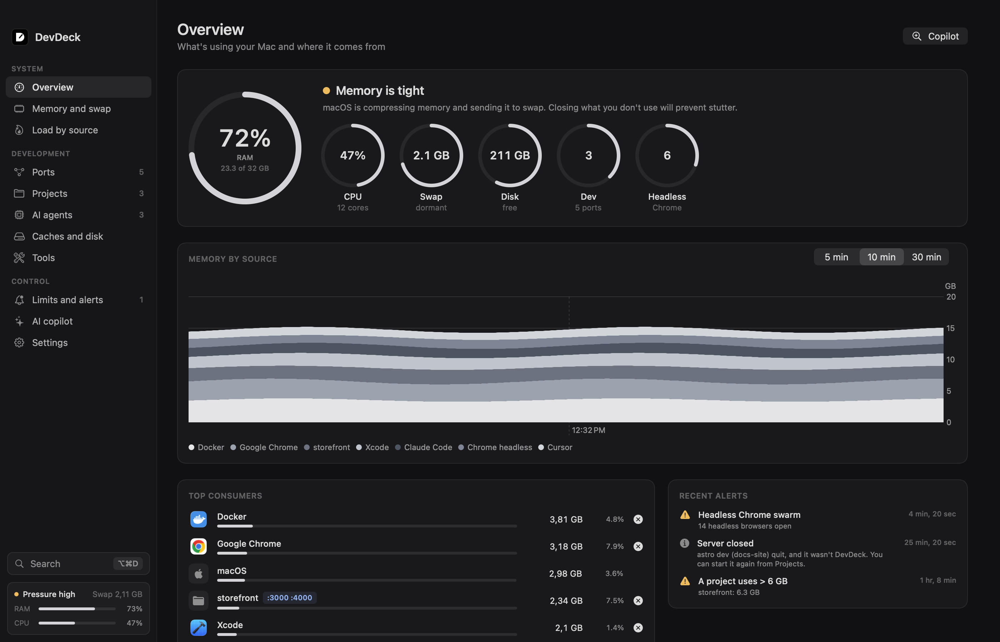
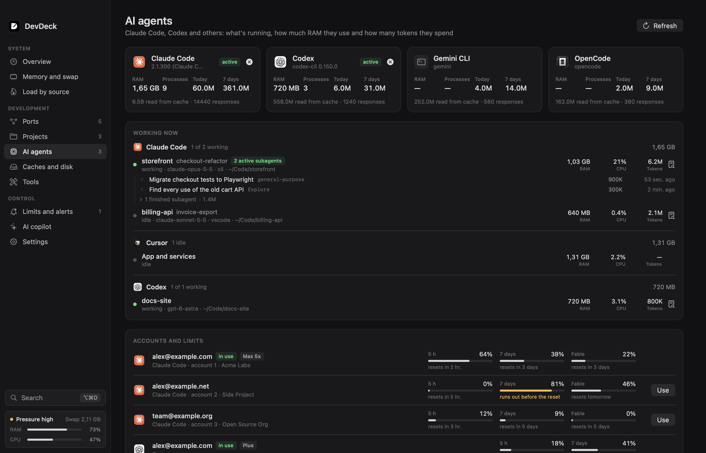
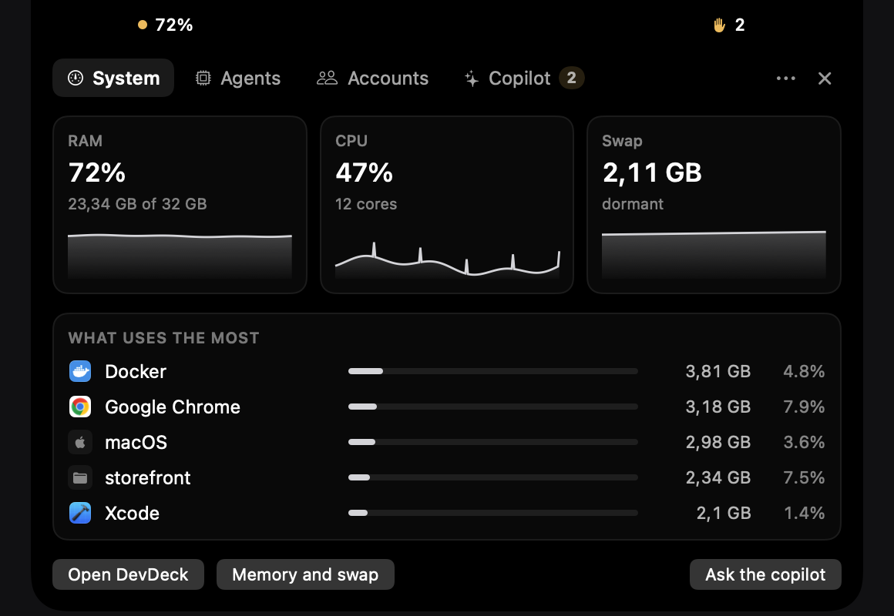
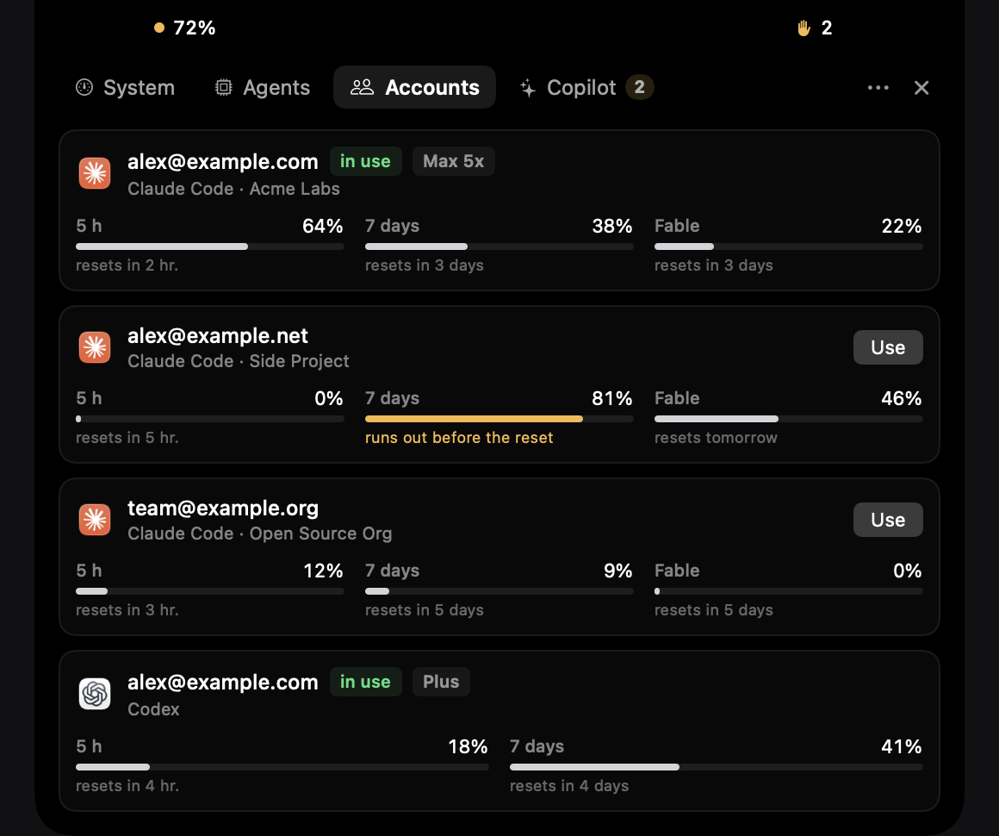
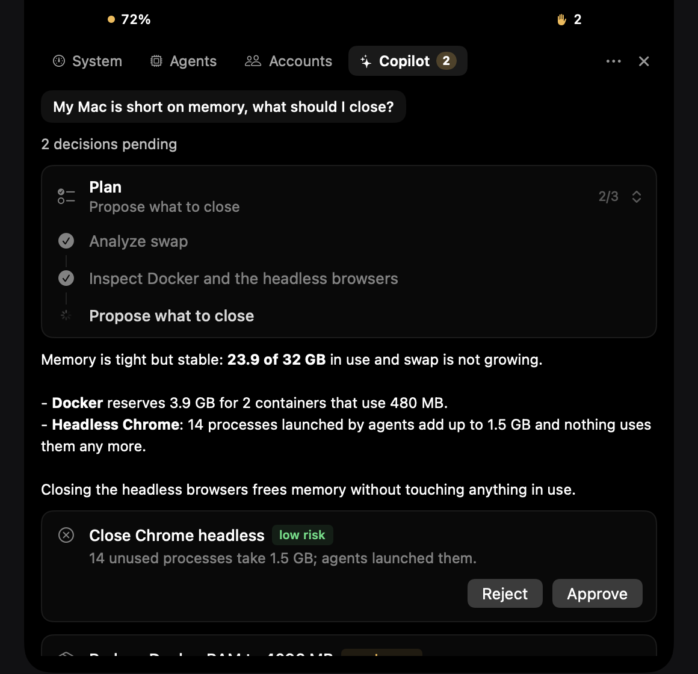

<div align="center">

# DevDeck

**Where is all this load coming from?**

A native macOS dashboard for developers: it attributes every gigabyte of RAM, every port and every swap spike to the project, AI agent, container or app behind it, and lets you act in one click.

[](https://github.com/SeanLuis/devdeck/actions/workflows/ci.yml)
[](LICENSE)


[Download](https://github.com/SeanLuis/devdeck/releases/latest) · [Features](#features) · [Build from source](#build-from-source) · [Español](README.es.md)



</div>

## Why

Activity Monitor tells you that `node` uses 1.8 GB. It does not tell you that it is the `next dev` of one project, that the 14 headless Chromes were left behind by a coding agent, or that Docker reserves 4 GB for two containers that use 500 MB.

DevDeck does. It is built for the way developers work now: several dev servers, a container VM, and a few AI agents running at once on one laptop.

- **Native and light.** SwiftUI, no Electron, no dependencies. About 90 MB of memory.
- **Local.** Everything is read from your Mac. Nothing leaves it unless you ask the copilot something.
- **Careful.** It never touches system processes, and every action the AI proposes waits for your approval.

## Features

### See where the load comes from

| | |
|---|---|
| **Overview** | RAM, memory pressure, swap, CPU and disk, with memory stacked **by source**: project, AI agent, browser, Docker, app. |
| **Memory and swap** | Whether swap is dormant (harmless) or active (slowing you down), growth per minute, compressed memory, thrashing detection, and who has memory out of RAM. |
| **Load by source** | Every process attributed to whoever launched it. MCP servers count for the agent that started them. Headless browsers show who launched them. |
| **Ports** | Every listening port with the project, dev server (Next.js, Vite, tsx…) and Docker container behind it. Open, restart or stop. |
| **Projects** | Running and discovered projects: services, ports, memory over time, containers, caches, `package.json` scripts, remembered commands and logs. |
| **Caches and disk** | `.next`, `node_modules`, `.turbo`, `target`, `.venv`… per project, plus global caches (npm, pnpm, uv, Homebrew, Xcode, Playwright…), each cleaned the right way. |
| **Tools** | Cleanup and maintenance commands for Docker, npm, pnpm, bun, yarn, uv, pip, Gradle, Homebrew and Xcode, only for what you have installed. |
| **Limits and alerts** | Rules with "sustained for N seconds" and cooldown: notify, kill, restart, or ask the AI for a diagnosis. |


### Keep an eye on your AI agents

- **Working now**: every open session with its folder, whether it is working or idle, RAM, CPU, tokens, and the **subagents** it spawned.
- **Accounts and limits**: your Claude Code accounts with their 5-hour, 7-day and per-model usage, and account switching with confirmation (through [claude-swap](https://github.com/realiti4/claude-swap) when installed). Codex account and plan.
- **Real icons** for apps and agents, taken from what is installed on your Mac; in colour, grey, or plain symbols.
- **Tokens** per day, per hour, per model and per project for **Claude Code, Codex, Devin, OpenCode and Gemini CLI**, read incrementally from what each agent logs locally.



### The island

A live pill at the top of the screen (it grows out of the notch on MacBooks). Click it and it opens into boards:

| System | Agents | Accounts | Copilot |
|---|---|---|---|
| RAM, CPU and swap with their recent history, and what uses the most | Tokens per hour and every open session | Limits per account, switch in two clicks | The copilot's plan and its pending decisions |

Pick the board it opens on, show it always, only when something needs attention, or turn it off.

<p align="center">


</p>
<p align="center">


</p>

### An AI copilot that asks before it acts

Press **⌥⌘D** from any app for a Raycast-style launcher: search commands, projects and ports, or just ask.

The copilot works as a turn-based agent. It shows its plan and the read-only tools it uses, then answers. Anything that changes your machine comes as a card with **Approve / Reject**, and you can decide right from the island without switching windows.

<p align="center">

</p>
<p align="center">

</p>

| Action | What it does |
|---|---|
| Close a group / kill a process | Orderly SIGTERM, after checking the PID is still the same process. |
| Restart a service | Same command, folder and environment. |
| Clean a cache | If it is in use, stops the services, deletes it and starts them again. |
| Alert when a group passes N MB | Creates an alert. |
| Reduce Docker's RAM | Changes the size of Docker Desktop's VM and restarts it. |
| Run a tool | Any recipe from Tools; the card shows the exact command and its output. |

It runs on **your own agent login**: Claude Code or Codex, with no API key (the CLI runs with no tools, no MCP servers and no saved history), or the OpenAI API with your key.

### Restart without losing anything

When DevDeck sees a dev server it remembers its command, folder and environment. Restart means an orderly SIGTERM to the process tree, waiting for the port to be free, and launching it exactly as it was. "Clean `.next` and restart" does the same with the cache deleted in between.

## Install

Download `DevDeck.zip` from the [latest release](https://github.com/SeanLuis/devdeck/releases/latest), unzip it and move `DevDeck.app` to Applications. The app is signed and notarized by Apple, and runs on Apple silicon and Intel.

Requires macOS 14 or later.

DevDeck checks for new versions once a day and shows you the release notes. It never installs anything by itself: updating is one click, and the download is verified to be signed and notarized before it replaces the app.

## Build from source

```bash
git clone https://github.com/SeanLuis/devdeck.git
cd devdeck
./scripts/bundle.sh          # release build, ad-hoc signature, installs to ~/Applications/DevDeck.app
open ~/Applications/DevDeck.app
```

Requires Xcode 16 or later (Swift 6). There are no third-party dependencies.

## Privacy and safety

- DevDeck never touches system processes, other users' processes or itself.
- Nothing is sent anywhere unless you use the copilot. When you do, the model receives a **redacted** summary: home paths become `~`, tokens and keys in command lines are masked, and environment variables are never included.
- Actions proposed by the AI are validated against the live state: only groups, PIDs and cache paths that exist. A card that names a PID is only applied if that process is still the same one.
- "Apply what is safe" autopilot only closes headless browsers and deletes regenerable build caches of stopped projects.
- Agent usage is read from local files only. Account e-mails are read to show them to you and are not stored or sent.
- Data lives in `~/Library/Application Support/DevDeck/`. The API key and remembered commands are stored with `600` permissions.

See [SECURITY.md](SECURITY.md) to report a vulnerability.

## Where agent data comes from

| Agent | Source |
|---|---|
| Claude Code | `~/.claude/projects/**.jsonl` (subagents under `<session>/subagents/`), open sessions in `~/.claude/sessions/` |
| Codex | `~/.codex/sessions/**.jsonl` |
| Devin | `~/.local/share/devin/cli/sessions.db` |
| OpenCode | `~/.local/share/opencode/opencode.db` |
| Gemini CLI | `~/.gemini/tmp/*/chats/*.json` |

Claude Code does not publish its usage limits on disk, so real percentages need [claude-swap](https://github.com/realiti4/claude-swap). Without it, DevDeck shows the current account and the tokens measured in the last 5 hours.

## Languages

English, Spanish and Portuguese, in Settings → Appearance. The copilot answers in the same language.

## Development

```bash
swift build
swift test
.build/debug/DevDeck --dump                       # what the classifier sees, as text
.build/debug/DevDeck --snapshot out --demo        # render every screen to PNG with made-up data
.build/debug/DevDeck --snapshot out --lang pt --light --only agents,rules --height 2000
.build/debug/DevDeck --usage-dump                 # agent tokens, sessions, subagents and accounts
.build/debug/DevDeck --agent-smoke "question"     # one full copilot conversation, as text
```

- `Sources/DevDeckCore`: process and port scanning with libproc, system statistics, project and framework detection, Docker, caches, rules, process control, agent usage and the AI clients. No UI, with tests.
- `Sources/DevDeck`: the SwiftUI app (window, menu bar, island, launcher, notifications).

Strings are written in Spanish inside `L("…")`; translations live in `L10n+English.swift` and `L10n+Portuguese.swift`, keyed by the Spanish text. A test fails if one is missing.

Contributions are welcome. Start with [CONTRIBUTING.md](CONTRIBUTING.md). Releases are signed and notarized by a workflow: see [docs/RELEASING.md](docs/RELEASING.md).

## Roadmap

- Token readers for more agents (Cursor, Aider, Amp)
- Per-project token budgets and alerts
- More languages

## License

[MIT](LICENSE)
