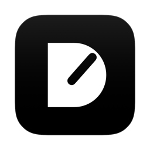
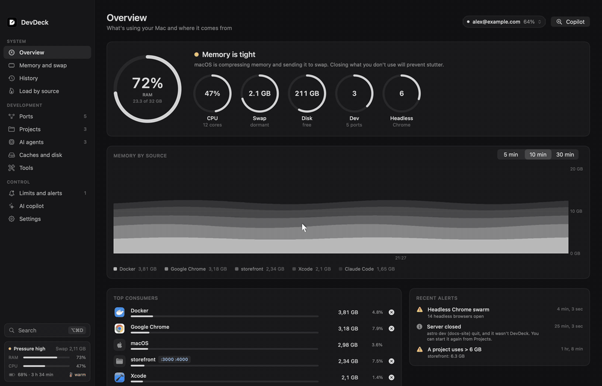
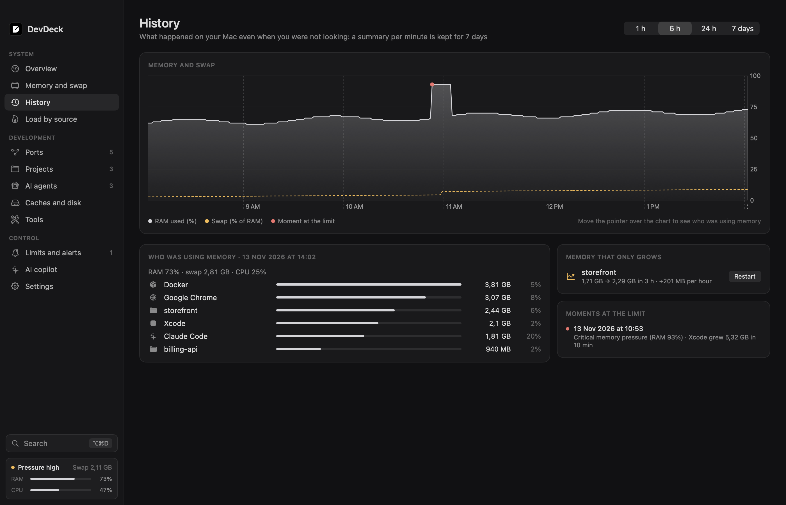
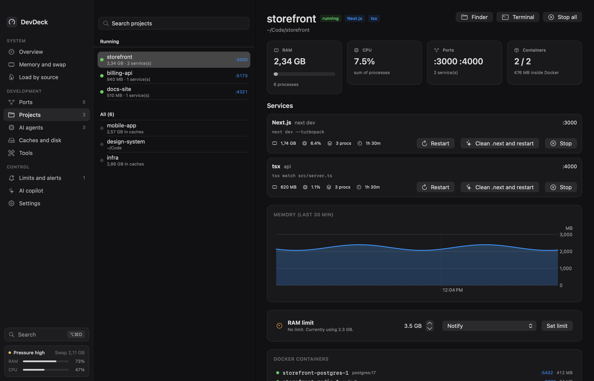
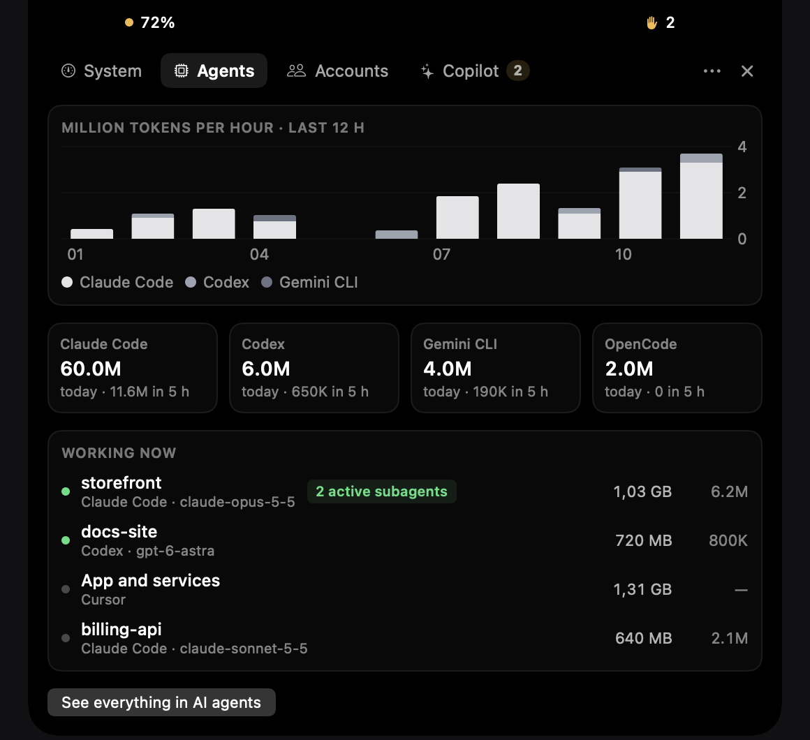
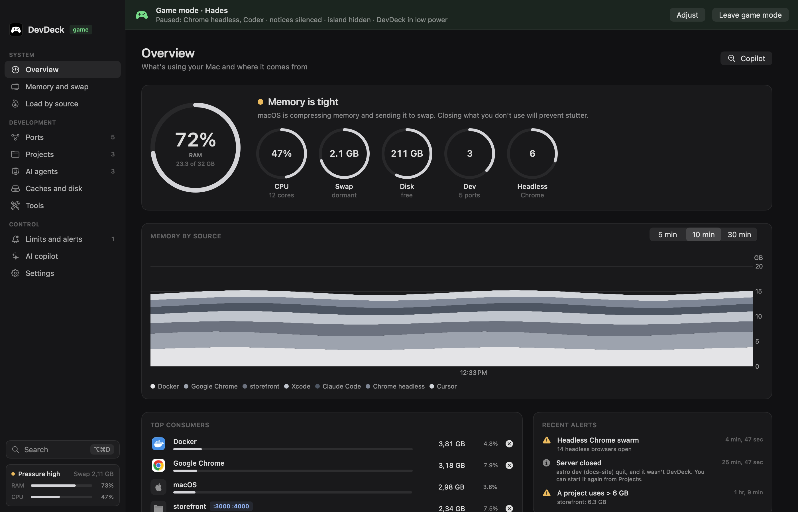
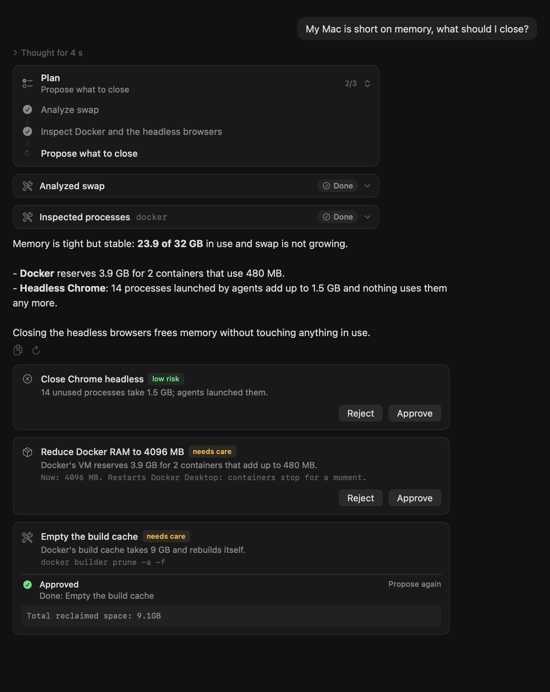
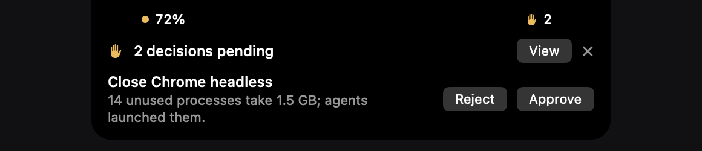

<div align="center">



# DevDeck

**A system monitor that knows what you are working on.**

DevDeck is a native macOS app that attributes memory, swap, CPU and listening ports to the project, AI coding agent, container or application responsible, and lets you act on it.

[](https://github.com/SeanLuis/devdeck/actions/workflows/ci.yml)
[](LICENSE)


[Download](https://github.com/SeanLuis/devdeck/releases/latest) · [Features](#features) · [Build from source](#build-from-source) · [Español](README.es.md)



</div>

## Why

A process list shows that `node` uses 1.8 GB. It does not show that the process is the dev server of a particular project, that 14 headless browsers were left behind by a coding agent, or that the container VM reserves 4 GB for two containers using 500 MB.

DevDeck makes that attribution. It is designed for a typical development machine today: several dev servers, a container VM and one or more AI coding agents running at the same time.

- **Native.** Written in SwiftUI with no third-party dependencies. Uses about 90 MB of memory.
- **Local.** Everything is read from your Mac. Nothing leaves it unless you ask the copilot something.
- **Conservative.** System processes are never touched, and every action proposed by the AI requires your approval.

## Features

### System and projects

| | |
|---|---|
| **History** | A summary per minute, kept for seven days: memory and swap over time, who was using memory at any given minute, the moments memory reached its limit and what grew just before, and processes whose memory only grows (likely leaks), with a recommendation to restart them. |
| **Overview** | RAM, memory pressure, swap, CPU and disk, with memory stacked **by source**: project, AI agent, browser, Docker, app. |
| **Memory and swap** | Whether swap is dormant (harmless) or active (slowing you down), growth per minute, compressed memory, thrashing detection, and who has memory out of RAM. **Free swap** lets you pick what to close, restart or reopen to get it back. |
| **Load by source** | Every process attributed to whoever launched it, and named for what it does: the 40 identical helpers of a browser become "Tab or window × 38", "GPU", "Network", "Extension"… MCP servers count for the agent that started them. Headless browsers show who launched them. |
| **Ports** | Every listening port with the project, dev server (Next.js, Vite, tsx…) and Docker container behind it. Open, restart or stop. |
| **Projects** | Running and discovered projects: services, ports, memory over time, containers, caches, `package.json` scripts, remembered commands and logs. |
| **Caches and disk** | `.next`, `node_modules`, `.turbo`, `target`, `.venv`… per project, plus global caches (npm, pnpm, uv, Homebrew, Xcode, Playwright…), each cleaned the right way. |
| **Tools** | Cleanup and maintenance commands for Docker, npm, pnpm, bun, yarn, uv, pip, Gradle, Homebrew and Xcode, only for what you have installed. |
| **Limits and alerts** | Rules with "sustained for N seconds" and cooldown: notify, kill, restart, or ask the AI for a diagnosis. Alerts come with a recommendation: one click asks the copilot what to do. |





### AI coding agents

- **Working now**: every open session with its folder, whether it is working or idle, RAM, CPU, tokens, and the **subagents** it spawned.
- **Accounts and limits**: your Claude Code accounts with their 5-hour, 7-day and per-model usage, and account switching with confirmation. DevDeck keeps the logins in its own keychain store, reads each account's real limits, and can import the accounts [claude-swap](https://github.com/realiti4/claude-swap) manages. Codex logins can be saved and switched too.
- **Real icons** for apps and agents, taken from what is installed on your Mac; in colour, grey, or plain symbols.
- **Tokens** per day, per hour, per model and per project for **Claude Code, Codex, Devin, OpenCode and Gemini CLI**, read incrementally from what each agent logs locally.


### The island

A live pill at the top of the screen (it grows out of the notch on MacBooks). Click it and it opens into boards:

| System | Agents | Accounts | Copilot |
|---|---|---|---|
| RAM, CPU and swap with their recent history, and what uses the most | Tokens per hour and every open session | Limits per account, switch in two clicks | The copilot's plan and its pending decisions |

Pick the board it opens on, show it always, only when something needs attention, or turn it off.

<p align="center">


</p>
<p align="center">


</p>

### Game mode

When a game starts, DevDeck recommends game mode (or turns it on by itself, if you prefer). While it is on:

- What you chose is **paused, not closed**: headless browsers, idle AI agents, dev servers, Docker. An agent that is working is never paused. Everything continues exactly where it was when you leave.
- Notices are silenced (critical alerts still get through), the island hides, and DevDeck itself drops to low power.
- The menu bar, the Dock and the app show the controller, so you always know it is on.

Games are detected by app category, by store folder (Steam, Epic, GOG…) or from your own list.



### AI copilot with explicit approval

Press **⌥⌘D** from any application to open the launcher: search commands, projects and ports, or ask a question.

The copilot works as a turn-based agent. It shows its plan and the read-only tools it uses, then answers. Anything that changes your machine comes as a card with **Approve / Reject**, and you can decide right from the island without switching windows.

<p align="center">

</p>
<p align="center">

</p>

| Action | What it does |
|---|---|
| Close a group / kill a process | Orderly SIGTERM, after checking the PID is still the same process. |
| Restart a service | Same command, folder and environment. |
| Clean a cache | If it is in use, stops the services, deletes it and starts them again. |
| Alert when a group passes N MB | Creates an alert. |
| Reduce Docker's RAM | Changes the size of Docker Desktop's VM and restarts it. |
| Run a tool | Any recipe from Tools; the card shows the exact command and its output. |

It runs on **your own agent login**: Claude Code (Sonnet for your questions, Haiku for automatic analyses; both configurable) or Codex, with no API key (the CLI runs with no tools, no MCP servers and no saved history), or the OpenAI API with your key.

### Restarting services

When DevDeck sees a dev server it remembers its command, folder and environment. Restart means an orderly SIGTERM to the process tree, waiting for the port to be free, and launching it exactly as it was. "Clean `.next` and restart" does the same with the cache deleted in between.

## Install

Download `DevDeck.zip` from the [latest release](https://github.com/SeanLuis/devdeck/releases/latest), unzip it and move `DevDeck.app` to Applications. The app is signed and notarized by Apple, and it is a universal binary: the same download runs on Apple silicon and Intel Macs.

Requires macOS 14 or later.

With Homebrew:

```bash
brew tap SeanLuis/devdeck https://github.com/SeanLuis/devdeck
brew install --cask devdeck
```

That also puts a `devdeck` command on your PATH.

DevDeck checks for new versions once a day and shows you the release notes. It never installs anything by itself: updating is one click, and the download is verified to be signed and notarized before it replaces the app.

## Project infrastructure

Put a `devdeck.json` at the root of a project (DevDeck can write it from the commands it has seen you run) and commit it:

```json
{
  "services": [
    { "name": "web", "command": "pnpm dev", "port": 3000, "health": "/api/health" },
    { "name": "api", "command": "tsx watch src/server.ts", "dir": "apps/api", "port": 4000 }
  ],
  "compose": "docker-compose.yml"
}
```

The project page then shows which services run and answer, and brings the whole project up or down with one button. The file holds no environment variables.

## Command line and MCP

The app's binary answers from a terminal too, without opening the window:

```bash
devdeck status          # memory, swap, CPU, disk and what uses the most
devdeck top             # what is using memory and CPU, by origin
devdeck ports           # listening ports and who owns them
devdeck agents --json   # tokens each coding agent spent
devdeck sessions "coupon"   # past agent sessions where that was said
devdeck branches        # branches and worktrees agents worked in
devdeck today           # the day per project: tokens, sessions, commits
```

Without Homebrew, link it yourself: `ln -s /Applications/DevDeck.app/Contents/MacOS/DevDeck /usr/local/bin/devdeck`.

`devdeck mcp` is a [Model Context Protocol](https://modelcontextprotocol.io) server over stdio, so a coding agent can check the machine before it starts another server. Its reading tools (`system_status`, `top_consumers`, `listening_ports`, `agent_usage`, `branches`, `today`) change nothing. Two more, `request_free_port` and `request_restart_server`, let the agent ask: DevDeck shows you the request and nothing happens unless you approve it there.

```bash
claude mcp add devdeck -- devdeck mcp
```

## Your own recipes

Tools runs maintenance commands with a click. Add your own in `~/Library/Application Support/DevDeck/toolkit.json`; the file is read again whenever it changes:

```json
[
  { "group": "Docker", "title": "Restart the proxy", "detail": "When routes stop resolving.",
    "command": ["docker", "restart", "proxy"], "destructive": false },
  { "title": "Clear the build folder", "command": ["rm -rf ~/Code/app/build"], "shell": true }
]
```

A recipe asks for confirmation before running unless it says `"destructive": false`.

## Build from source

```bash
git clone https://github.com/SeanLuis/devdeck.git
cd devdeck
./scripts/bundle.sh          # release build, ad-hoc signature, installs to ~/Applications/DevDeck.app
open ~/Applications/DevDeck.app
```

Requires Xcode 16 or later (Swift 6). There are no third-party dependencies. The script builds for your Mac's architecture; `UNIVERSAL=1 ./scripts/bundle.sh` builds for Apple silicon and Intel.

## Privacy and safety

- DevDeck never touches system processes, other users' processes or itself.
- Nothing is sent anywhere unless you use the copilot. When you do, the model receives a **redacted** summary: home paths become `~`, tokens and keys in command lines are masked, and environment variables are never included.
- Actions proposed by the AI are validated against the live state: only groups, PIDs and cache paths that exist. A card that names a PID is only applied if that process is still the same one.
- "Apply what is safe" autopilot only closes headless browsers and deletes regenerable build caches of stopped projects.
- DevDeck only calls a model when you ask the copilot or when an alert triggers an automatic analysis, and it keeps a ledger of what it spent itself (Settings → AI), separate from your agents' usage.
- Agent usage is read from local files only. Account e-mails are read to show them to you and are not stored or sent.
- Data lives in `~/Library/Application Support/DevDeck/`. The API key and remembered commands are stored with `600` permissions.

See [SECURITY.md](SECURITY.md) to report a vulnerability.

## Where agent data comes from

| Agent | Source |
|---|---|
| Claude Code | `~/.claude/projects/**.jsonl` (subagents under `<session>/subagents/`), open sessions in `~/.claude/sessions/` |
| Codex | `~/.codex/sessions/**.jsonl` |
| Devin | `~/.local/share/devin/cli/sessions.db` |
| OpenCode | `~/.local/share/opencode/opencode.db` |
| Gemini CLI | `~/.gemini/tmp/*/chats/*.json` |

Claude Code does not publish its usage limits on disk, so DevDeck asks the account itself, with the login Claude Code already has. Without a saved account it shows the current one and the tokens measured in the last 5 hours.

## Languages

English, Spanish and Portuguese, in Settings → Appearance. The copilot answers in the same language.

## Development

```bash
swift build
swift test
.build/debug/DevDeck --dump                       # what the classifier sees, as text
.build/debug/DevDeck --snapshot out --demo        # render every screen to PNG with made-up data
.build/debug/DevDeck --snapshot out --lang pt --light --only agents,rules --height 2000
.build/debug/DevDeck --usage-dump                 # agent tokens, sessions, subagents and accounts
.build/debug/DevDeck --agent-smoke "question"     # one full copilot conversation, as text
```

- `Sources/DevDeckCore`: process and port scanning with libproc, system statistics, project and framework detection, Docker, caches, rules, process control, agent usage and the AI clients. No UI, with tests.
- `Sources/DevDeck`: the SwiftUI app (window, menu bar, island, launcher, notifications).

Strings are written in Spanish inside `L("…")`; translations live in `L10n+English.swift` and `L10n+Portuguese.swift`, keyed by the Spanish text. A test fails if one is missing.

Contributions are welcome. Start with [CONTRIBUTING.md](CONTRIBUTING.md). Releases are signed and notarized by a workflow: see [docs/RELEASING.md](docs/RELEASING.md).

## Roadmap

- Token readers for more agents (Cursor, Aider, Amp)
- A widget and Shortcuts actions
- More languages

## License

[PolyForm Noncommercial 1.0.0](LICENSE). You may use, study, modify and share DevDeck for any noncommercial purpose, keeping the copyright notice. Commercial use needs written permission from the author. Versions up to 0.1.4 were released under the MIT License.
